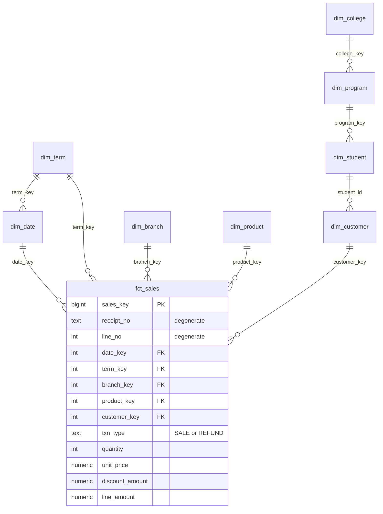

# Grain and star schema

## Business process

Retail sales at the campus bookstore and canteen counters.

## Grain

**One row per item sold per receipt.** That is one receipt line: `receipt_no` + `line_no`.
A receipt with three items is three fact rows. A refund line is also one row.

## Star schema

The empty tables are created by `sql/00_setup/02_star_schema.sql`. Read that file for every column and type.

| Table | Schema | One row is | Key from the source | History |
|---|---|---|---|---|
| `fct_sales` | `mart` | one receipt line | `receipt_no`, `line_no` | latest version of the line |
| `dim_product` | `mart` | one product in one price period | `product_code` | **Type 2** on `unit_price`; Type 1 (overwrite) on name and category |
| `dim_branch` | `mart` | one branch | `branch_code` | Type 1 |
| `dim_customer` | `mart` | one registered buyer (student or staff) | `customer_id` | Type 1. Row `-1` = unknown buyer |
| `dim_date` | `shared` | one calendar day | the date | none. Cover 2025-08-01 to 2026-07-31 |
| `dim_term` | `shared` | one academic term | `term_code` | none. Row `-1` = no term |
| `dim_student` | `shared` | one student | `student_id` | built Type 2-ready; one current row each for now |
| `dim_program` | `shared` | one degree program | `program_code` | none |
| `dim_college` | `shared` | one college | `college_code` | none |

## Facts

| Fact | Meaning | Can it be added up? |
|---|---|---|
| `quantity` | units on the line, always more than 0 | yes, but subtract REFUND lines yourself |
| `unit_price` | price of one unit on the day of the sale | no |
| `discount_amount` | pesos taken off the line | yes |
| `line_amount` | quantity × unit_price − discount_amount, always positive | yes within one `txn_type`; use the net sales metric across both |

## Surrogate key rules

- Every dimension key is made by the warehouse. Source codes are kept as columns, never used as keys.
- `date_key` is the date as a number: `20260317`. `term_key` is the term as a number: `20251`.
- A sale finds its `product_key` by `product_code` **and** by time: the row whose `valid_from` ≤ `sold_at` < `valid_to`.
- A sale with no customer, or with a customer id the store does not know, gets `customer_key = -1`.
- A sale on a day outside every term gets `term_key = -1`.

## Class standards for the shared tables

These are the same rules the whole class will sign in the Course Project team contract.

| Item | Standard |
|---|---|
| Table prefixes | `stg_` staging, `int_` intermediate, `dim_` dimension, `fct_` fact |
| Student id | trimmed, upper case, `S` + 7 digits, for example `S2024012` |
| Term code | `2025-1`, `2025-2`, `2025-3` (academic year start, then term number) |
| Colleges | exactly 5: `CCS` College of Computer Studies · `CoE` College of Engineering · `CBA` College of Business Administration · `CAL` College of Arts and Letters · `CoS` College of Science |
| A "current" row | `is_current = true` and `valid_to = 9999-12-31` |
