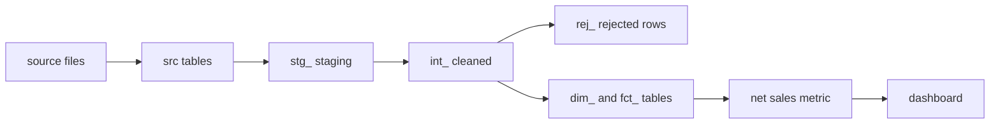

# Lineage: from source files to the dashboard

Replace this diagram with your own. Name the real tables, views and scripts in your repository.
Show at least one column traced from start to end, for example `line_total` → `line_amount` → net sales.

For each arrow, write which script moves the data and what it changes.
