# Lineage: from source files to the dashboard

## End-to-End Pipeline Diagram

```mermaid
flowchart LR
    subgraph SRC_FILES["Source Extracts (source/)"]
        F1["01_initial_load.sql<br/>02_enrollment_extract.sql"]
        F2["03_daily_sales_may15.sql<br/>04_change_log_and_prices_may16.sql<br/>05_late_sales_and_new_column_may19.sql<br/>06_reextract_2026-03-17.sql"]
    end

    subgraph SRC["1. Raw Source (src.*)"]
        S1["src.sales, src.products,<br/>src.branches, src.customers"]
        S2["src.enroll_students,<br/>src.enroll_courses,<br/>src.enroll_enrollments"]
        S3["src.sales_change_log,<br/>src.sales_reextract_20260317"]
    end

    subgraph STG["2. Staging (stg.*)"]
        ST1["stg.stg_sales, stg.stg_products,<br/>stg.stg_branches, stg.stg_customers,<br/>stg.stg_enroll_*"]
    end

    subgraph INT["3. Intermediate & Rejects (int.*, rej.*)"]
        I1["int.int_sales, int.int_products,<br/>int.int_branches, int.int_customers,<br/>int.int_enroll_*"]
        R1["rej.rej_sales<br/>int.int_sales_dedup_removed"]
    end

    subgraph MART["4. Dimensional Mart & Shared (mart.*, shared.*, audit.*)"]
        D1["shared.dim_date, shared.dim_term,<br/>shared.dim_college, shared.dim_program,<br/>shared.dim_student"]
        D2["mart.dim_branch, mart.dim_product (SCD2),<br/>mart.dim_customer"]
        FACT["mart.fct_sales<br/>(RLS: rls_fct_sales_branch_only)"]
        AUD["audit.etl_watermark,<br/>audit.deleted_sales_keys,<br/>audit.branch_manager_map,<br/>audit.dq_test_results"]
    end

    subgraph SEM["5. Governed Metric & Analytics"]
        V1["mart.v_net_sales<br/>(security_invoker = true)"]
        MV1["mart.mv_net_sales_branch_term<br/>(Executive Summary MV)"]
        Q1["sql/06_analytics/business_questions.sql<br/>(Q1–Q6)"]
    end

    subgraph BI["6. Consumption"]
        DASH["Campus Store Dashboard<br/>(Store Manager & Branch Managers)"]
    end

    F1 --> S1
    F1 --> S2
    F2 --> S1
    F2 --> S3

    S1 -- "01_stage_source.sql<br/>(1:1 copy + batch_id)" --> ST1
    S2 -- "01_stage_source.sql<br/>(1:1 copy + batch_id)" --> ST1

    ST1 -- "01_clean_sales.sql<br/>02_clean_dimensions.sql<br/>03_clean_enrollment.sql<br/>(dedupe, trim, parse dates/prices)" --> I1
    ST1 -- "01_clean_sales.sql<br/>(invalid math/qty/date/FK)" --> R1

    I1 -- "03_shared_dimensions.sql<br/>(conform 5 colleges, terms)" --> D1
    I1 -- "01_load_dimensions.sql<br/>(surrogate keys + -1 unknowns)" --> D2
    I1 -- "02_load_fct_sales.sql<br/>(point-in-time SK lookup)" --> FACT

    S1 -- "01_watermark_load.sql<br/>03_scd2_product_price.sql<br/>04_late_data_and_new_column.sql<br/>(watermark CDC, SCD2, order_channel)" --> D2
    S1 -- "01_watermark_load.sql<br/>04_late_data_and_new_column.sql" --> FACT
    S3 -- "02_change_log_load.sql (I/U/D + LSN)<br/>05_rerun_and_backfill.sql (2026-03-17)" --> FACT
    S3 -- "tombstones & watermarks" --> AUD
    AUD -. "guards reruns & RLS" .-> FACT

    D1 --> FACT
    D2 --> FACT

    FACT -- "04_metric_net_sales.sql<br/>(SALE: +line_amount, REFUND: -line_amount)" --> V1
    V1 -- "business_questions.sql<br/>(pre-aggregated Q1)" --> MV1
    V1 --> Q1
    V1 -- "Governed Net Sales<br/>(RLS enforced)" --> DASH
    MV1 -- "Store-level KPI" --> DASH
```

## Column-Level Lineage Trace: `line_total` → `line_amount` → `net_sales`

| Stage | Object.Column | Script | Transformation Applied |
| :--- | :--- | :--- | :--- |
| **Source** | `src.sales.line_total` (`text`) | `source/01_initial_load.sql`, `03`–`06` | Raw POS string (may include `PHP`, commas, spaces, or math errors) |
| **Staging** | `stg.stg_sales.line_total` (`text`) | `sql/01_staging/01_stage_source.sql` | Exact 1:1 mirror with `batch_id` and `staged_at` metadata |
| **Intermediate** | `int.int_sales.line_amount` (`numeric(12,2)`) | `sql/02_intermediate/01_clean_sales.sql` | Deduplicated on `(receipt_no, line_no)` by newest `updated_at`; stripped `PHP`/commas; validated `ROUND(qty * unit_price - discount, 2) = line_amount` (invalid rows routed to `rej.rej_sales`) |
| **Fact** | `mart.fct_sales.line_amount` (`numeric(12,2)`) | `sql/03_marts/02_load_fct_sales.sql` & `sql/05_cdc/01–05` | Upserted on `(receipt_no, line_no)` with SCD2 point-in-time `product_key`; voided rows physically deleted and tombstoned in `audit.deleted_sales_keys`; protected by RLS policy `rls_fct_sales_branch_only` |
| **Governed Metric** | `mart.v_net_sales.net_sales` (`numeric(12,2)`) | `sql/03_marts/04_metric_net_sales.sql` | `CASE WHEN txn_type = 'SALE' THEN line_amount WHEN txn_type = 'REFUND' THEN -line_amount ELSE 0 END` with `security_invoker = true` |
| **Analytics & BI** | `SUM(net_sales)` (`₱1,541,459.50`) | `sql/06_analytics/business_questions.sql` & Dashboard | Aggregated across `dim_branch`, `dim_term`, `dim_date`, `dim_product`, `dim_customer`, and `shared.dim_college` |